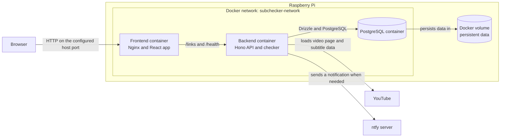
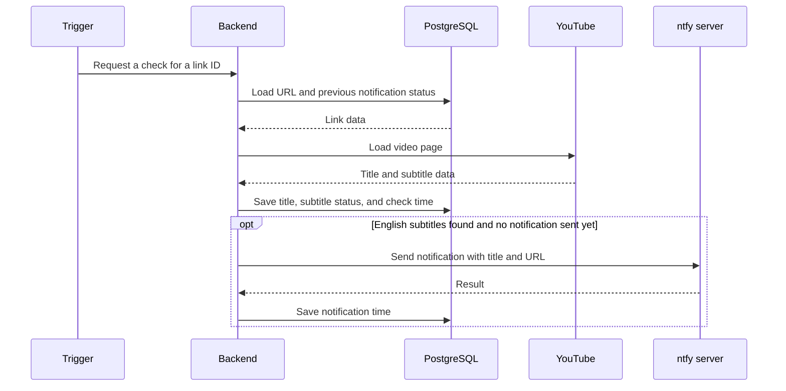
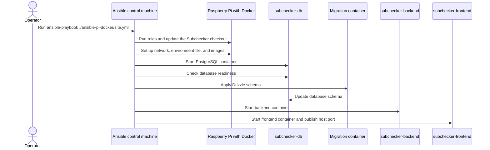

# Subchecker Architecture

This document explains how the web app, backend, and database work together, and how Ansible deploys Subchecker to the Raspberry Pi. The diagrams reflect the current code and playbooks.

## Runtime on the Raspberry Pi

The browser communicates only with the frontend container. Nginx serves the web app and forwards API requests to the backend over the internal Docker network. The backend and database are not published directly to the host network.

The host port is currently configured as `5173` and can be changed with `subchecker_host_port`. On the Docker network, the backend is reachable at `subchecker-backend:3000` and the database at `subchecker-db:5432`.

## Subtitle-check flow

A check starts when a link is added, when a user requests a manual check, or automatically. The backend runs the checker once at startup and then every six hours.

If YouTube data cannot be loaded, the check fails. A failed ntfy request is logged and `notifiedAt` is not set, so a later check can try sending the notification again.

## Deployment with Homelab

The `ansible-pi-docker/site.yml` playbook runs the `subchecker` role on the Pi, among others. This role updates the checkout, creates the Docker network and images, starts the database, waits for it to become available, applies the Drizzle schema, and then starts the backend and frontend.

The environment file is generated from `roles/subchecker/templates/subchecker.env.j2`. Passwords and the ntfy topic come from the encrypted Ansible Vault and should not be added to this document.

**Database note:** The playbook starts Subchecker’s database as a dedicated Docker container (`postgres:16`) with a persistent Docker volume. The separate Ansible role named `postgresql` is not included in `site.yml`, so it is not the database used by this Subchecker deployment.

## Local development

Locally, `docker compose` in `subchecker-backend` starts only PostgreSQL. The backend runs separately on port `3000`; the web app's Vite development server proxies `/links` and `/health` to it. On the Raspberry Pi, Nginx in the frontend container handles this proxying instead.

## Related code and configuration

- Backend routes and server startup: [subchecker-backend/src/index.ts](subchecker-backend/src/index.ts), [subchecker-backend/src/links.ts](subchecker-backend/src/links.ts)
- Check flow and external requests: [subtitleChecker.ts](subchecker-backend/src/lib/subtitleChecker.ts), [fetchSubtitleInfo.ts](subchecker-backend/src/lib/fetchSubtitleInfo.ts), [notify.ts](subchecker-backend/src/lib/notify.ts)
- Database schema: [schema.ts](subchecker-backend/src/db/schema.ts)
- Frontend API: [links.ts](subchecker-web-app/src/api/links.ts)
- Nginx proxy on the Pi: [nginx.conf](subchecker-web-app/nginx.conf)
- Homelab roles and Subchecker deployment: [site.yml](../homelab/ansible-pi-docker/site.yml), [Subchecker tasks](../homelab/ansible-pi-docker/roles/subchecker/tasks/main.yml), [environment template](../homelab/ansible-pi-docker/roles/subchecker/templates/subchecker.env.j2)